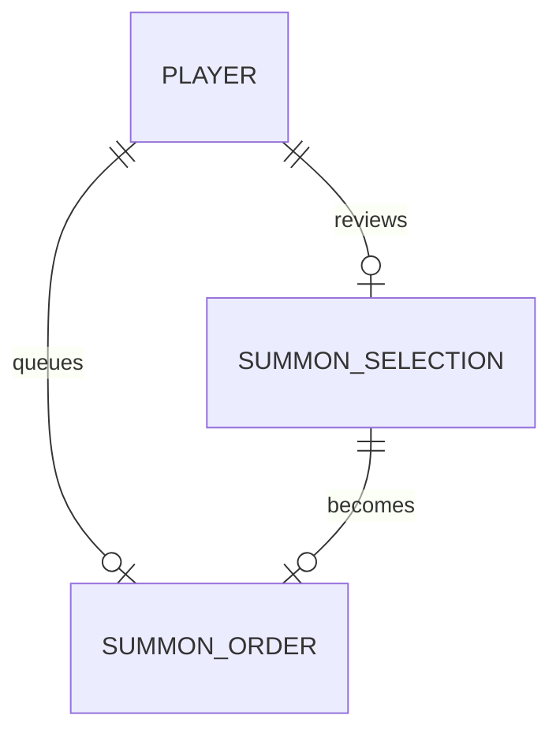

# Entity Model

## Entity Relationship Diagram

### PLAYER

Represents the active CTP2 player whose summon state is held in SLIC arrays.

| Attribute | Description | Data Type | Length/Precision | Validation Rules |
|---|---|---|---|---|
| id | CTP2 player index | Integer | 10 | Primary Key |

### SUMMON_SELECTION

Represents the creature selected for review before a summon order is committed.

| Attribute | Description | Data Type | Length/Precision | Validation Rules |
|---|---|---|---|---|
| playerId | Player who owns the pending selection | Integer | 10 | Primary Key, Foreign Key (PLAYER.id) |
| unitType | Selected UnitDB index | Integer | 10 | Not Null |
| creatureRung | Rung used to price and time this creature | Integer | 10 | Not Null, Min: 1, Max: 5 |
| effectiveManaCost | Cost shown before confirmation | Integer | 10 | Not Null |
| channelTurns | Turns shown before confirmation | Integer | 10 | Not Null, Min: 1, Max: 5 |

### SUMMON_ORDER

Represents the confirmed creature stored for the existing BeginTurn summon processor.

| Attribute | Description | Data Type | Length/Precision | Validation Rules |
|---|---|---|---|---|
| playerId | Player who owns the order | Integer | 10 | Primary Key, Foreign Key (PLAYER.id) |
| unitType | Confirmed UnitDB index | Integer | 10 | Not Null |

#### Constraints

- `SUMMON_SELECTION` is runtime-only; pressing `0` clears it and pressing `1` transfers its `unitType` to `SUMMON_ORDER`.
- The SLIC representation uses `MomSummonPendingChoice[player]`, `MomSummonReviewCostDisp`, and `MomSummonReviewTurnsDisp`; the committed order remains `MomSummonChoice[player]`.
- `effectiveManaCost = ((45 + 30 * creatureRung) * civilizationPercent) / 100` using integer division.
- `channelTurns = creatureRung`; the existing BeginTurn processor supplies the delayed summon result message.
- One pending selection and one unprocessed summon order exist per player at most.
